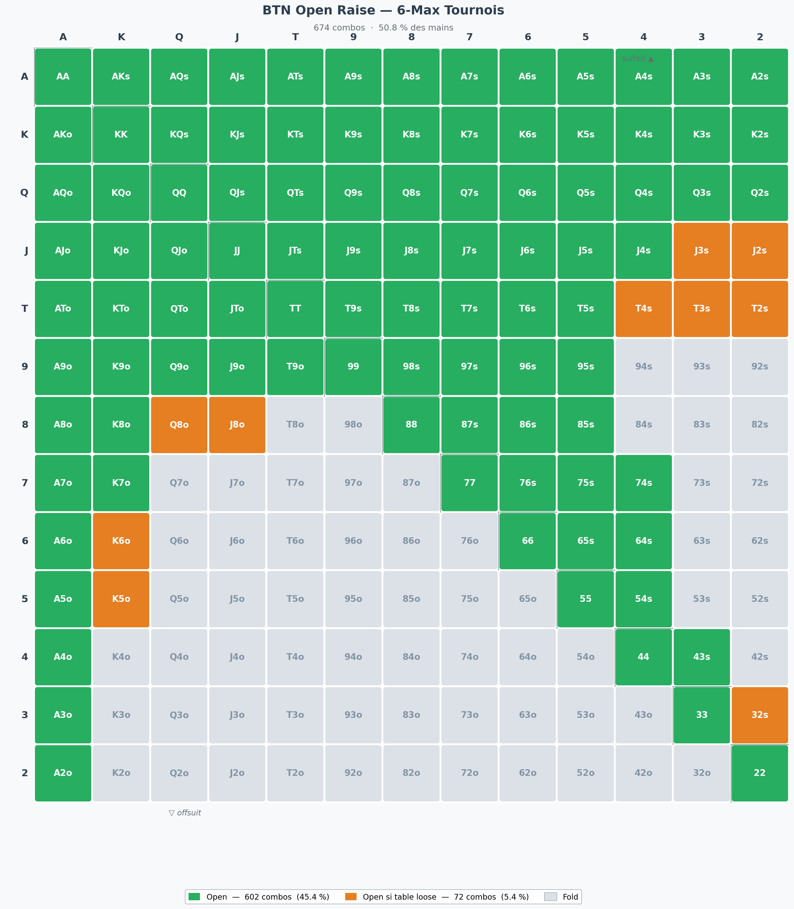
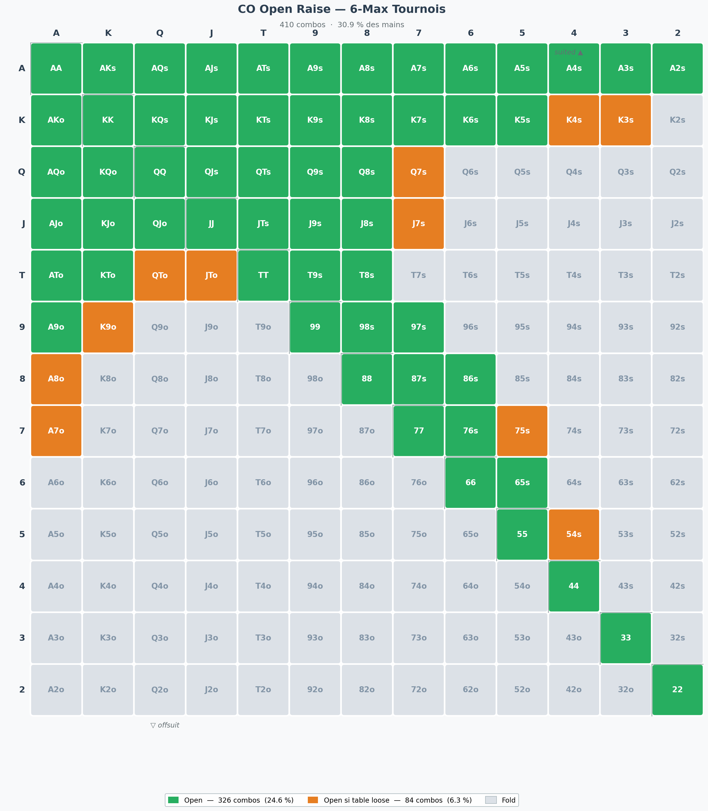
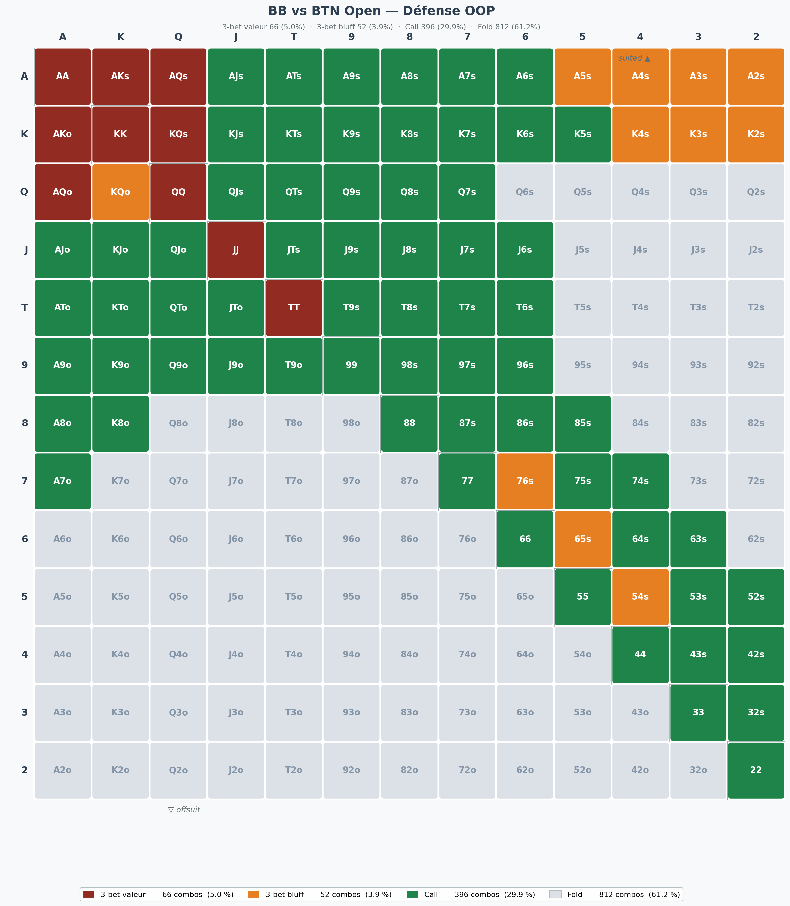

# Poker Tournament Decision Engine (Monte Carlo Equity + ICM)

A Texas Hold'em decision engine for tournaments (MTT / SNG): given the table state, it estimates
hand equity by Monte Carlo simulation, computes the EV of fold / call / raise, and adjusts the
decision for tournament payout pressure with the **Independent Chip Model (ICM)**.

## Features
- **Monte Carlo equity** against one or several opponent ranges (`engine/equity_calc.py`),
  using `treys` lookup-table hand evaluation.
- **EV per action** (fold / call / raise) from pot odds and simulated equity.
- **Malmuth–Harville ICM** (`engine/icm.py`): converts stacks into prize equity, measures
  bubble pressure and the next pay jump, and scales the required equity accordingly.
- **Recommender** (`engine/recommender.py`) returning the action, equity, EV and reasoning.
- Interactive **CLI** (`cli.py`), a 6-max **preflop range notebook** (`ranges_preflop.ipynb`)
  and a browser **preflop trainer** (`trainer.html`).

## Quick start
```bash
pip install -r requirements.txt
python cli.py
python -m pytest test_icm.py
```
Open `trainer.html` in a browser for the preflop trainer.

## Preflop ranges (6-max)
| BTN open | CO open | BB vs BTN |
|---|---|---|
|  |  |  |

> Study tool only: it is not meant to be used during real-money play.
